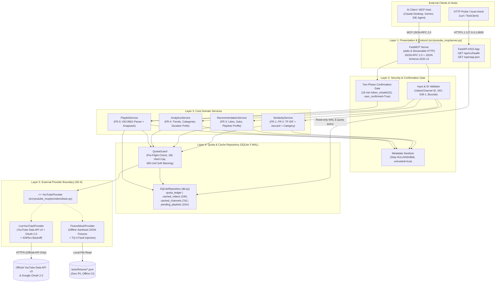
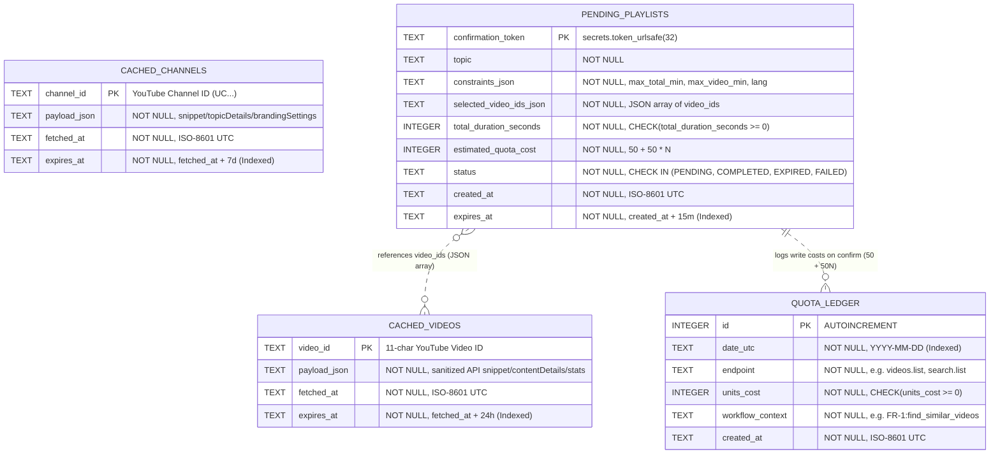
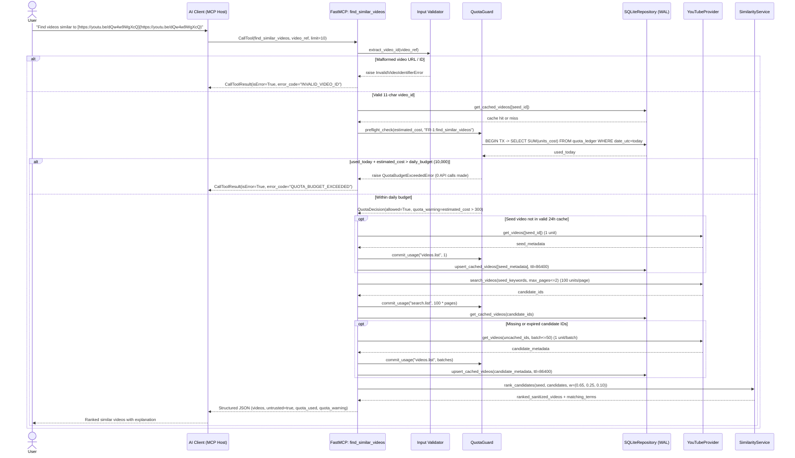
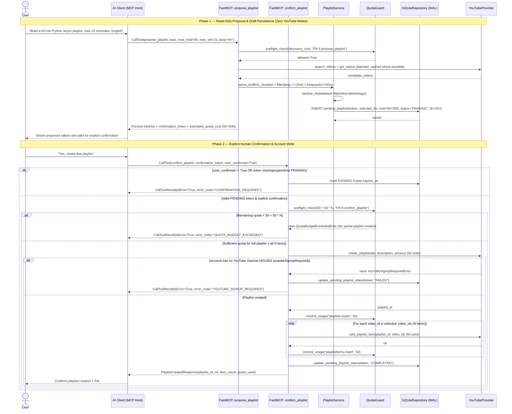
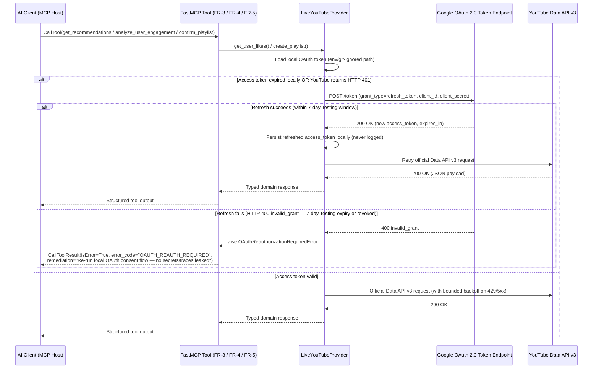

# System Architecture & Design Documentation (`SE-2`)

**Project:** YouTube Video Intelligence MCP Server  
**Stage:** Stage 2 — Architecture & Design  
**Traceable Requirements:** `SE-2`, `SE-3`, `SE-6`, `SE-7`, `FR-1`..`FR-5`, `TQ-1`..`TQ-6`, `REQ-DB-1`..`REQ-DB-4`, `NFR-PERF-1`..`3`, `NFR-QUAL-1`..`4`, `NFR-SAFE-1`..`3`, `NFR-SEC-1`..`4`  
**Governing ADRs:** [ADR-001](adr/001-python-fastmcp-and-fastapi-runtime.md), [ADR-002](adr/002-sqlite-wal-storage-and-cache-ttl.md), [ADR-003](adr/003-provider-interface-isolation.md), [ADR-004](adr/004-similarity-scoring-and-weights.md), [ADR-005](adr/005-two-phase-playlist-confirmation-and-prompt-injection.md), [ADR-006](adr/006-preflight-quota-guard-and-warning-threshold.md)

---

## 1. Architectural Overview & Decision Summary

The system is a local-first Python 3.11+ ASGI application combining **FastMCP** (`mcp>=1.28,<2`) for Model Context Protocol (MCP) tools/resources and **FastAPI** for read-only HTTP health and OpenAPI documentation (`127.0.0.1:8000`). All external YouTube Data API v3 and Google OAuth 2.0 calls sit strictly behind an abstract `YouTubeProvider` boundary (`SE-6`), while quota enforcement, metadata caching, and two-phase playlist drafts persist in an embedded **SQLite 3 WAL-mode** database.

| Concern | Concrete Stage 2 Design Choice | Governing ADR |
|---|---|---|
| Runtime & Transports | Python 3.11+, `FastMCP` (`stdio` + Streamable HTTP) + `FastAPI` (`GET /api/v1/health`, `GET /openapi.json`) | [ADR-001](adr/001-python-fastmcp-and-fastapi-runtime.md) |
| Persistence & Cache TTL (`TBD-03`) | SQLite 3 (`journal_mode=WAL`, `busy_timeout=5000`, `foreign_keys=ON`); `cached_videos` TTL = **24h**, `cached_channels` TTL = **7d** | [ADR-002](adr/002-sqlite-wal-storage-and-cache-ttl.md) |
| External Isolation (`SE-6`, `TQ-5`) | Abstract `YouTubeProvider` (`LiveYouTubeProvider` vs. `FixtureMockProvider`), zero scraping, minimal OAuth scopes | [ADR-003](adr/003-provider-interface-isolation.md) |
| Similarity Weights (`TBD-02`) | Deterministic TF-IDF cosine + tag Jaccard + category match: $w_1=0.65,\; w_2=0.25,\; w_3=0.10$ with missing-tag re-weighting ($0.8667 / 0.1333$) | [ADR-004](adr/004-similarity-scoring-and-weights.md) |
| Playlist Safety & Injection (`FR-5`) | Two-phase gate (`propose_playlist` -> 15-min SQLite token -> `confirm_playlist`) + untrusted metadata sanitization | [ADR-005](adr/005-two-phase-playlist-confirmation-and-prompt-injection.md) |
| Quota Guard (`TQ-6`, `TBD-01`) | Hard atomic pre-flight block at `10,000` units/day; **300-unit** soft warning threshold; `max_search_pages = 2` | [ADR-006](adr/006-preflight-quota-guard-and-warning-threshold.md) |

---

## 2. System Component / Layered Architecture Diagram (UML Component)

The architecture enforces strict top-down dependency flow across five layers. Domain services never import Google API SDKs or HTTP transport clients directly (`SE-6`), and diagnostic logs in `stdio` mode are routed exclusively to `stderr` (`ADR-001`).



---

## 3. Database Entity-Relationship (ER) Diagram

All durable state is stored in a single local-disk SQLite 3 database initialized with `PRAGMA journal_mode=WAL;`, `PRAGMA busy_timeout=5000;`, and `PRAGMA foreign_keys=ON;` (`ADR-002`).



### Schema Constraints & Indexing Rules
* **`quota_ledger`:** Composite index `idx_quota_ledger_date_utc ON quota_ledger(date_utc)` keeps pre-flight `SUM(units_cost)` lookups sub-millisecond.
* **`cached_videos` & `cached_channels`:** Indexed on `expires_at`. A row is a valid cache hit (`0` quota units) only if `expires_at > CURRENT_TIMESTAMP`; stale rows are overwritten inside an ACID transaction on refresh (`ADR-002`).
* **`pending_playlists`:** Status transitions are strictly one-way (`PENDING -> COMPLETED`, `PENDING -> EXPIRED`, or `PENDING -> FAILED`) inside an ACID transaction to prevent duplicate playlist creation on replay (`ADR-005`). Dashed ER lines indicate logical cross-references (because `selected_video_ids_json` is a JSON array rather than a hard foreign key).

---

## 4. UML Class Diagram (Core Interfaces & Services)

```mermaid
classDiagram
    class YouTubeProvider {
        <<abstract>>
        +get_videos(video_ids: list~str~) list~VideoMetadata~*
        +get_channels(channel_ids: list~str~, handle: str) list~ChannelMetadata~*
        +search_videos(query: str, max_results: int, page_token: str, language: str) SearchPage*
        +get_user_likes(max_results: int) list~VideoMetadata~*
        +get_user_subscriptions(max_results: int) list~ChannelMetadata~*
        +get_user_playlists(max_results: int) list~PlaylistSummary~*
        +get_playlist_items(playlist_id: str, max_results: int) list~str~*
        +create_playlist(title: str, description: str, privacy_status: str) CreatedPlaylist*
        +add_playlist_item(playlist_id: str, video_id: str) PlaylistItemResult*
    }

    class LiveYouTubeProvider {
        -api_key: str
        -oauth_credentials_path: Path
        -max_retries: int
        +get_videos(video_ids: list~str~) list~VideoMetadata~
        +get_channels(channel_ids: list~str~, handle: str) list~ChannelMetadata~
        +search_videos(query: str, max_results: int, page_token: str, language: str) SearchPage
        +get_user_likes(max_results: int) list~VideoMetadata~
        +get_user_subscriptions(max_results: int) list~ChannelMetadata~
        +get_user_playlists(max_results: int) list~PlaylistSummary~
        +get_playlist_items(playlist_id: str, max_results: int) list~str~
        +create_playlist(title: str, description: str, privacy_status: str) CreatedPlaylist
        +add_playlist_item(playlist_id: str, video_id: str) PlaylistItemResult
        -_refresh_oauth_token() None
        -_request_with_backoff(endpoint: str, params: dict) dict
    }

    class FixtureMockProvider {
        -fixtures_dir: Path
        -fault_mode: str
        +get_videos(video_ids: list~str~) list~VideoMetadata~
        +get_channels(channel_ids: list~str~, handle: str) list~ChannelMetadata~
        +search_videos(query: str, max_results: int, page_token: str, language: str) SearchPage
        +get_user_likes(max_results: int) list~VideoMetadata~
        +get_user_subscriptions(max_results: int) list~ChannelMetadata~
        +get_user_playlists(max_results: int) list~PlaylistSummary~
        +get_playlist_items(playlist_id: str, max_results: int) list~str~
        +create_playlist(title: str, description: str, privacy_status: str) CreatedPlaylist
        +add_playlist_item(playlist_id: str, video_id: str) PlaylistItemResult
        +inject_fault(error_type: str) None
    }

    class SQLiteRepository {
        -db_path: Path
        +initialize_schema() None
        +get_used_quota(date_utc: str) int
        +record_quota_usage(endpoint: str, units: int, context: str) None
        +get_cached_videos(video_ids: list~str~) dict~str, VideoMetadata~
        +upsert_cached_videos(videos: list~VideoMetadata~, ttl_seconds: int) None
        +get_cached_channels(channel_ids: list~str~) dict~str, ChannelMetadata~
        +upsert_cached_channels(channels: list~ChannelMetadata~, ttl_seconds: int) None
        +save_pending_playlist(draft: PendingPlaylist) None
        +get_pending_playlist(token: str) PendingPlaylist
        +update_pending_playlist_status(token: str, status: str) None
        +check_wal_health() dict
    }

    class QuotaGuard {
        -repo: SQLiteRepository
        -daily_budget: int
        -soft_warning_threshold: int
        -max_search_pages: int
        +estimate_cost(operations: list~QuotaOperation~) int
        +preflight_check(estimated_cost: int, workflow_context: str) QuotaDecision
        +commit_usage(endpoint: str, units: int, workflow_context: str) None
        +remaining_budget() int
    }

    class MetadataSanitizer {
        +sanitize_text(raw: str, max_length: int) str
        +sanitize_video(video: VideoMetadata) SanitizedVideo
        +sanitize_channel(channel: ChannelMetadata) SanitizedChannel
    }

    class SimilarityService {
        -provider: YouTubeProvider
        -quota_guard: QuotaGuard
        -repo: SQLiteRepository
        -sanitizer: MetadataSanitizer
        -w_tfidf: float
        -w_tags: float
        -w_category: float
        +find_similar_videos(video_ref: str, limit: int) SimilarVideosResponse
        +find_similar_channels(channel_ref: str, limit: int) SimilarChannelsResponse
        +compute_composite_score(seed: VideoMetadata, candidate: VideoMetadata) SimilarityScore
    }

    class RecommendationService {
        -provider: YouTubeProvider
        -quota_guard: QuotaGuard
        -repo: SQLiteRepository
        -similarity: SimilarityService
        +recommend_for_user(limit: int) RecommendationsResponse
    }

    class AnalyticsService {
        -provider: YouTubeProvider
        -quota_guard: QuotaGuard
        -repo: SQLiteRepository
        +analyze_engagement(period_days: int, compare_previous: bool) EngagementReport
    }

    class PlaylistService {
        -provider: YouTubeProvider
        -quota_guard: QuotaGuard
        -repo: SQLiteRepository
        -sanitizer: MetadataSanitizer
        +parse_iso8601_duration(duration: str) int
        +pack_videos_knapsack(candidates: list, max_total_s: int, max_vid_s: int) list
        +propose_playlist(request: PlaylistProposalRequest) PlaylistProposalResponse
        +confirm_playlist(token: str, user_confirmed: bool, title: str, privacy: str) PlaylistCreatedResponse
    }

    YouTubeProvider <|-- LiveYouTubeProvider
    YouTubeProvider <|-- FixtureMockProvider
    QuotaGuard --> SQLiteRepository : reads/writes ledger
    SimilarityService --> YouTubeProvider
    SimilarityService --> QuotaGuard
    SimilarityService --> SQLiteRepository
    SimilarityService --> MetadataSanitizer
    RecommendationService --> YouTubeProvider
    RecommendationService --> QuotaGuard
    RecommendationService --> SimilarityService
    AnalyticsService --> YouTubeProvider
    AnalyticsService --> QuotaGuard
    PlaylistService --> YouTubeProvider
    PlaylistService --> QuotaGuard
    PlaylistService --> SQLiteRepository
    PlaylistService --> MetadataSanitizer
```



---

## 5. Critical Flow Sequence Diagrams (UML Sequence)

### 5.1 Flow 1: `FR-1` Similar Videos + Pre-Flight Quota Guard (`TQ-6`, `ADR-004`, `ADR-006`)



### 5.2 Flow 2: `FR-5` Two-Phase Playlist Creation (`ADR-005`, `ADR-006`)



### 5.3 Flow 3: OAuth 2.0 Token Refresh & 7-Day Testing Expiry (`TQ-4`, `ADR-003`)



---

## 6. Module, Tool & Error Contract Specification

### 6.1 MCP Tool Input / Output Schemas (JSON Schema Draft 2020-12)

All six tools are registered via `@mcp.tool()` on `FastMCP` (`ADR-001`). Every text field originating from YouTube is sanitized and flagged as untrusted data (`ADR-005`).

#### 1. `find_similar_videos` (`FR-1`)
* **Input:**
  ```json
  {
    "video_ref": "string (YouTube URL or 11-char video ID, required)",
    "limit": "integer (default: 10, min: 1, max: 25)"
  }
  ```
* **Output:**
  ```json
  {
    "seed_video_id": "dQw4w9WgXcQ",
    "results": [
      {
        "video_id": "abc123XYZ09",
        "title": "Sanitized Video Title",
        "channel_title": "Sanitized Channel",
        "duration_seconds": 742,
        "similarity_score": 0.8421,
        "score_breakdown": { "tfidf": 0.81, "tags": 0.90, "category": 1.0 },
        "matching_terms": ["async", "python", "event-loop"],
        "untrusted_metadata": true
      }
    ],
    "quota_used": 102,
    "remaining_daily_quota": 9898,
    "quota_warning": null
  }
  ```

#### 2. `find_similar_channels` (`FR-2`)
* **Input:**
  ```json
  {
    "channel_ref": "string (Channel URL, @handle, or UC... ID, required)",
    "limit": "integer (default: 10, min: 1, max: 20)"
  }
  ```
* **Output:**
  ```json
  {
    "seed_channel_id": "UC_x5XG1OV2P6uZZ5FSM9Ttw",
    "results": [
      {
        "channel_id": "UC1234567890abcdef",
        "title": "Sanitized Channel Title",
        "similarity_score": 0.785,
        "matching_topics": ["Programming", "Systems"],
        "avg_upload_duration_seconds": 910,
        "untrusted_metadata": true
      }
    ],
    "quota_used": 103,
    "remaining_daily_quota": 9795,
    "quota_warning": null
  }
  ```

#### 3. `get_recommendations` (`FR-3`)
* **Input:**
  ```json
  {
    "limit": "integer (default: 10, min: 1, max: 25)",
    "exclude_known_videos": "boolean (default: true)"
  }
  ```
* **Output:**
  ```json
  {
    "profile_summary": {
      "top_topics": ["systems", "linux", "networking"],
      "source_counts": { "likes": 40, "subscriptions": 18, "playlists": 5 }
    },
    "recommendations": [
      {
        "video_id": "xyz98765432",
        "title": "Sanitized Video Title",
        "channel_title": "Sanitized Channel",
        "duration_seconds": 860,
        "relevance_score": 0.79,
        "matching_terms": ["linux", "sockets"],
        "untrusted_metadata": true
      }
    ],
    "quota_used": 105,
    "remaining_daily_quota": 9690,
    "quota_warning": null
  }
  ```

#### 4. `analyze_user_engagement` (`FR-4`)
* **Input:**
  ```json
  {
    "period_days": "integer (default: 30, min: 7, max: 365)",
    "compare_previous_period": "boolean (default: true)"
  }
  ```
* **Output:**
  ```json
  {
    "period_days": 30,
    "top_channels": [{ "channel_id": "UC...", "channel_title": "Sanitized", "count": 12 }],
    "top_categories": [{ "category_id": "28", "count": 24 }],
    "duration_preferences": {
      "mean_seconds": 845,
      "median_seconds": 720,
      "buckets": { "short_lt_5m": 4, "medium_5m_20m": 19, "long_gt_20m": 7 }
    },
    "trends_over_time": [{ "month": "2026-11", "liked_count": 15 }],
    "period_comparison": { "current_count": 15, "previous_count": 11, "delta_pct": 36.36 },
    "quota_used": 4,
    "remaining_daily_quota": 9686
  }
  ```

#### 5. `propose_playlist` (`FR-5` — Phase 1, Read-Only + Draft)
* **Input:**
  ```json
  {
    "topic": "string (required, non-empty)",
    "max_total_duration_minutes": "integer (required, min: 5, max: 600)",
    "max_video_duration_minutes": "integer (optional, min: 1, max: 240)",
    "language": "string (optional, ISO 639-1 e.g. 'en')"
  }
  ```
* **Output:**
  ```json
  {
    "confirmation_token": "urlsafe-random-32-byte-token",
    "expires_at": "2026-11-27T05:15:00Z",
    "proposed_videos": [
      {
        "video_id": "vid00000001",
        "title": "Sanitized Video Title",
        "duration_seconds": 780,
        "relevance_score": 0.91,
        "untrusted_metadata": true
      }
    ],
    "total_duration_seconds": 3340,
    "estimated_write_quota_cost": 300,
    "requires_explicit_user_confirmation": true,
    "quota_warning": null
  }
  ```

#### 6. `confirm_playlist` (`FR-5` — Phase 2, Write Gate)
* **Input:**
  ```json
  {
    "confirmation_token": "string (required)",
    "user_confirmed": "boolean (required, must be true)",
    "playlist_title": "string (required, max 150 chars)",
    "playlist_description": "string (optional, max 5000 chars)",
    "privacy_status": "string (enum: 'private' | 'unlisted' | 'public', default: 'private')"
  }
  ```
* **Output:**
  ```json
  {
    "status": "COMPLETED",
    "playlist_id": "PLxxxxxxxxxxxxxxxx",
    "playlist_url": "[https://www.youtube.com/playlist?list=PLxxxxxxxxxxxxxxxx](https://www.youtube.com/playlist?list=PLxxxxxxxxxxxxxxxx)",
    "items_added": 5,
    "quota_used": 300,
    "remaining_daily_quota": 9386
  }
  ```

---

### 6.2 Custom Exception Hierarchy & MCP Error Mapping

All domain exceptions inherit from `YouTubeMCPError` and are translated by the FastMCP handler into `ToolError` / `CallToolResult(isError=True)` containing only `error_code`, `message`, and `remediation`—never raw stack traces, OAuth tokens, or API keys (`ADR-001`, `ADR-003`).

```text
YouTubeMCPError (base)
├── InvalidVideoIdentifierError       # Malformed video/channel URL, handle, or ID (TQ-4)
├── VideoUnavailableError             # Private, deleted, or nonexistent video/channel (TQ-4)
├── QuotaBudgetExceededError          # Pre-flight TQ-6 rejection OR live 403 quotaExceeded
├── ConfirmationRequiredError         # Missing user_confirmed=True, invalid/expired/replayed token (FR-5)
├── OAuthReauthorizationRequiredError # Missing token or expired 7-day Testing refresh token (TQ-4)
└── YouTubeSignupRequiredError        # Google account lacks an initialized YouTube channel (TQ-4, FR-5)
```

| Exception Class | `error_code` | Trigger Condition | Safe User Remediation |
|---|---|---|---|
| `InvalidVideoIdentifierError` | `INVALID_IDENTIFIER` | Input fails video ID / channel ID / handle validation | Provide a valid YouTube URL, 11-char video ID, `@handle`, or `UC...` channel ID. |
| `VideoUnavailableError` | `VIDEO_UNAVAILABLE` | API returns empty item list (private/deleted) | Verify the video is public/accessible and retry with another ID. |
| `QuotaBudgetExceededError` | `QUOTA_BUDGET_EXCEEDED` | `used_today + estimated_cost > daily_budget` or upstream `quotaExceeded` | Wait for UTC midnight quota reset, reduce result scope, or rely on cached entries. |
| `ConfirmationRequiredError` | `CONFIRMATION_REQUIRED` | `user_confirmed != True`, unknown token, already completed, or >15m TTL | Re-run `propose_playlist` and obtain explicit human confirmation before calling `confirm_playlist`. |
| `OAuthReauthorizationRequiredError` | `OAUTH_REAUTH_REQUIRED` | Access token unrefreshable (`invalid_grant`, 7-day Testing expiry) | Re-run the local OAuth 2.0 authorization flow to issue a fresh refresh token. |
| `YouTubeSignupRequiredError` | `YOUTUBE_SIGNUP_REQUIRED` | `playlists.insert` returns `youtubeSignupRequired` | Create a YouTube channel on the authenticated Google account before creating playlists. |

---

### 6.3 Read-Only HTTP & OpenAPI Contract (`SE-7`, `SK-4`)

Served by `FastAPI` bound to `127.0.0.1:8000` (configurable via `HOST` / `PORT`). Zero YouTube API quota is ever consumed by HTTP diagnostic endpoints (`ADR-001`).

* **`GET /api/v1/health`** — Used by `local-check` (`SK-4`) to verify SQLite WAL initialization and remaining daily quota.
  * **Response (`200 OK`, `application/json`):**
    ```json
    {
      "status": "ok",
      "service": "youtube-video-intelligence-mcp",
      "journal_mode": "wal",
      "daily_quota_budget": 10000,
      "remaining_quota": 10000
    }
    ```
  * **Degraded Response (`503 Service Unavailable`):** Returned if SQLite cannot be opened or `journal_mode != "wal"`.
* **`GET /openapi.json`** & **`GET /docs`** — Auto-generated OpenAPI 3.x specification and Swagger UI for HTTP routes (`SE-7`).
