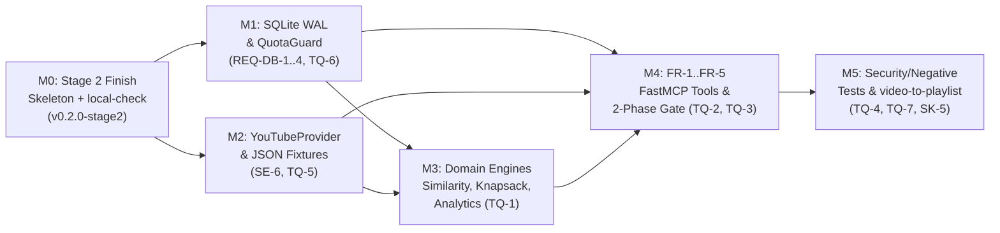

# Development Plan & Task Breakdown (`SE-4`)

**Project:** YouTube Video Intelligence MCP Server  
**Current Stage:** Stage 2 (Architecture & Design) → Stage 3 (Implementation & Verification)  
**Last Updated:** 2026-11-27  
**Traceable Artifacts:** [docs/srs.pdf](srs.pdf) | [docs/architecture.md](architecture.md) | [docs/adr/README.md](adr/README.md) | [docs/traceability-matrix.md](traceability-matrix.md)

---

## 1. Execution Strategy & Engineering Constraints

Development follows vertical, testable slices governed by our Stage 2 Architecture Decision Records (`ADR-001`–`ADR-006`) and `CONTRIBUTING.md`:

1. **Issue-First & PR-Gated (`SB-5`):** Every implementation module, test suite, skill, and Second Brain update begins with a GitHub Issue, develops on `<type>/<issue-number>-<short-description>`, and merges via Pull Request with green CI and at least one peer approval.
2. **Offline-First CI (`TQ-5`, `NFR-PERF-1`):** All PR test runs execute strictly against `FixtureMockProvider` and sanitized JSON fixtures in `tests/fixtures/` in under 15 seconds—never calling the live YouTube Data API v3.
3. **Quota & Security by Construction (`TQ-6`, `NFR-SEC-2`):** The SQLite WAL repository (`M1`) and abstract `YouTubeProvider` boundary (`M2`) land before any functional MCP tools (`M4`) so every workflow inherits pre-flight quota enforcement and metadata sanitization from day one.
4. **Visible Team Attribution (`SB-6`):** Work is split across three parallel tracks, with every team member authoring code/docs, contributing Second Brain updates, and reviewing peer PRs.

---

## 2. Team Track Ownership

| Track                                                     | Primary Owner | Secondary / Reviewer | Scope                                                                                                                                                                  |
| --------------------------------------------------------- | ------------- | -------------------- | ---------------------------------------------------------------------------------------------------------------------------------------------------------------------- |
| **Track A — Skills, Second Brain & QA**                   | `Pranay`      | `Rajvardhan`         | `brain-refine`, `brain-query`, `video-to-playlist`, negative/security tests (`TQ-4`), skill evals (`TQ-7`), stage reviews (`SB-2`)                                     |
| **Track B — Architecture, Core Math & Domain Logic**      | `Abhinav`     | `Rajvardhan`         | `docs/architecture.md`, `docs/development-plan.md`, `docs/traceability-matrix.md`, `SimilarityService`, `PlaylistService`, `AnalyticsService`, `RecommendationService` |
| **Track C — Runtime, Storage, Providers & `local-check`** | `Rajvardhan`  | `Pranay`             | `FastAPI` + `FastMCP` server (`server.py`), SQLite WAL (`db.py`), `QuotaGuard`, `YouTubeProvider` (`base.py`, `mock.py`, `live.py`), `local-check` skill (`SK-4`)      |

*(Replace `<Teammate A>` and `<Teammate B>` with GitHub handles or full names before merging.)*

---

## 3. Milestone Dependency Graph

---

## 4. Detailed Milestone & Task Breakdown

### Milestone M0: Stage 2 Completion & Runnable Server Skeleton
**Goal:** Close all remaining Stage 2 deliverables, deliver a bootable `FastAPI` + `FastMCP` server with `GET /api/v1/health`, verify `local-check` end-to-end, and tag `v0.2.0-stage2`.  
**Dependencies:** ADRs (`#20`) and Architecture Doc (`#22`).

| Task ID | Deliverable / Scope                                                                                                                                                                        | Requirements / ADRs                         | Owner        | GitHub Issue | Target Date |
| ------- | ------------------------------------------------------------------------------------------------------------------------------------------------------------------------------------------ | ------------------------------------------- | ------------ | ------------ | ----------- |
| `M0.1`  | Write `docs/development-plan.md` & `docs/traceability-matrix.md`                                                                                                                           | `SE-4`, `SE-5`                              | `Abhinav`    | `#22`        | 2026-11-27  |
| `M0.2`  | Scaffold `src/youtube_mcp/` (`config.py`, `db.py` WAL init + 4 tables, `providers/base.py`, `providers/mock.py`, `server.py` with `GET /api/v1/health` + OpenAPI)                          | `SE-6`, `SE-7`, `REQ-DB-1`, `ADR-001`–`003` | `Rajvardhan` | `#26`        | 2026-11-27  |
| `M0.3`  | Add offline unit/integration tests `tests/test_db_wal.py` and `tests/test_health.py` (`TestClient`); pin `pyproject.toml` deps (`mcp>=1.28,<2`, `fastapi`, `uvicorn`, `httpx`, `pydantic`) | `TQ-1`, `TQ-2`, `TQ-5`, `ADR-001`           | `Pranay`     | `#27`        | 2026-11-27  |
| `M0.4`  | Implement `.agents/skills/local-check/SKILL.md` (`SK-4`) + clean teardown helper (`scripts/run_local_check.py`)                                                                            | `SK-4`, `SB-3`, Section 3                   | `Pranay`     | `#28`        | 2026-11-27  |
| `M0.5`  | Run `TQ-7` skill evaluations for `brain-ingest`, `brain-refine`, `brain-query`, `local-check` (on ≥2 machines), record in `docs/test-results.md`, and log `ai-session` note                | `TQ-7`, Section 6                           | `Abhinav`    | `#29`        | 2026-11-27  |
| `M0.6`  | Write `brain/projects/stage-2-review.md`, update `brain/index.md`, `brain/log.md`, `CHANGELOG.md`, and push tag `v0.2.0-stage2`                                                            | `SB-2`, `SB-6`                              | `Abhinav`    | `#30`        | 2026-11-27  |

**Exit Criteria:** `local-check` prints `PASS` for all 5 steps; CI is green across all PRs; `v0.2.0-stage2` tag pushed.

---

### Milestone M1: SQLite WAL Repository & Pre-Flight Quota Guard
**Goal:** Complete full ACID repository methods for all 4 SQLite tables and implement atomic `TQ-6` pre-flight quota checking with the 300-unit soft warning threshold.  
**Dependencies:** `M0.2`.

| Task ID | Deliverable / Scope | Requirements / ADRs | Owner | GitHub Issue | Target Date |
|---|---|---|---|---|---|
| `M1.1` | Implement `SQLiteRepository` CRUD + TTL queries (`cached_videos` 24h, `cached_channels` 7d, `pending_playlists` 15m one-way status transitions) | `REQ-DB-1`–`4`, `NFR-PERF-3`, `NFR-SAFE-3`, `ADR-002` | `<Teammate B>` | `#<ID>` | 2026-12-02 |
| `M1.2` | Implement `QuotaGuard` (`estimate_cost`, atomic `preflight_check` against 10,000-unit daily cap, `SOFT_WARNING_THRESHOLD_UNITS=300`, `max_search_pages=2`, `commit_usage`) | `TQ-6`, `CON-3`, `NFR-SAFE-1`, `TBD-01`, `ADR-006` | `<Teammate B>` | `#<ID>` | 2026-12-03 |
| `M1.3` | Write `tests/test_repository.py` and `tests/test_quota_guard.py` verifying zero-cost cache hits, stale refresh, pre-flight rejection before provider call, and 300-unit soft warning | `TQ-1`, `TQ-6`, `ADR-002`, `ADR-006` | `<Teammate B>` | `#<ID>` | 2026-12-04 |

**Exit Criteria:** Any workflow exceeding remaining daily quota raises `QuotaBudgetExceededError` with 0 provider calls verified by unit tests.

---

### Milestone M2: `YouTubeProvider` Boundary, OAuth 2.0 & Offline JSON Fixtures
**Goal:** Deliver production-grade `LiveYouTubeProvider` and deterministic `FixtureMockProvider` behind `YouTubeProvider` (`SE-6`) with sanitized fixtures for offline CI.  
**Dependencies:** `M0.2` (runs in parallel with `M1`).

| Task ID | Deliverable / Scope | Requirements / ADRs | Owner | GitHub Issue | Target Date |
|---|---|---|---|---|---|
| `M2.1` | Define typed domain models (`VideoMetadata`, `ChannelMetadata`, `SearchPage`, `CreatedPlaylist`), custom exception hierarchy (`YouTubeMCPError` + 6 subclasses), and full `YouTubeProvider` ABC | `SE-6`, `NFR-QUAL-1`, `ADR-003` | `<Teammate B>` | `#<ID>` | 2026-12-02 |
| `M2.2` | Build sanitized JSON fixture corpus in `tests/fixtures/` (zero PII/tokens: videos, channels, untagged videos, likes, subscriptions, playlists, error payloads) and full `FixtureMockProvider` with `inject_fault()` | `TQ-4`, `TQ-5`, `NFR-SEC-4`, `ADR-003` | `<Teammate A>` | `#<ID>` | 2026-12-03 |
| `M2.3` | Implement `LiveYouTubeProvider` using official YouTube Data API v3 (`CON-1`), minimal OAuth scopes, `access_type=offline` refresh flow (handling 7-day Testing expiry → `OAuthReauthorizationRequiredError`), `youtubeSignupRequired` mapping, and bounded exponential backoff on HTTP 429/5xx | `CON-1`, `NFR-QUAL-2`, `NFR-SAFE-2`, `NFR-SEC-1`, `TQ-4`, `ADR-003` | `<Teammate B>` | `#<ID>` | 2026-12-05 |
| `M2.4` | Write `tests/test_provider_contract.py` verifying mock/live schema parity, backoff retries (via mocked HTTP transport), and domain error mapping | `TQ-2`, `TQ-4`, `TQ-5` | `<Teammate A>` | `#<ID>` | 2026-12-05 |

**Exit Criteria:** Zero direct imports of `googleapiclient` or `httpx` outside `src/youtube_mcp/providers/`; full offline fixture suite passes in `<5s`.

---

### Milestone M3: Core Domain Services (Similarity, Playlist Packing & Analytics)
**Goal:** Implement pure, deterministic business logic for ranking, recommendations, analytics, duration parsing, knapsack curation, and metadata sanitization.  
**Dependencies:** `M1`, `M2`.

| Task ID | Deliverable / Scope | Requirements / ADRs | Owner | GitHub Issue | Target Date |
|---|---|---|---|---|---|
| `M3.1` | Implement `InputValidator` (11-char video ID/URL, `UC...` channel ID/`@handle`, ISO 639-1) and `MetadataSanitizer` (strip NUL/ANSI/bidi/control chars, bound lengths, tag `untrusted_metadata=True`) | `NFR-SEC-2`, `TQ-4`, `ADR-005` | `Abhinav` | `#<ID>` | 2026-12-06 |
| `M3.2` | Implement `SimilarityService` (NFC normalization, $2\times$ title / $1\times$ description smoothed TF-IDF cosine, tag Jaccard, category match, weights $0.65 / 0.25 / 0.10$, missing-tag re-weighting $0.8667 / 0.1333$, channel aggregation, deterministic tie-breaking) | `FR-1`, `FR-2`, `NFR-PERF-2`, `TBD-02`, `ADR-004` | `Abhinav` | `#<ID>` | 2026-12-07 |
| `M3.3` | Implement `RecommendationService` (`FR-3` user likes/subs/playlists profile) and `AnalyticsService` (`FR-4` top channels/categories, duration buckets, monthly trends, period comparison) | `FR-3`, `FR-4` | `Abhinav` | `#<ID>` | 2026-12-08 |
| `M3.4` | Implement `PlaylistService` (strict ISO-8601 duration regex excluding malformed values, language & max-video filtering, bounded knapsack optimizer, Phase 1 draft persistence + Phase 2 atomic confirmation & `50 + 50N` quota gate) | `FR-5`, `NFR-SAFE-2`, `ADR-005`, `ADR-006` | `Abhinav` | `#<ID>` | 2026-12-09 |
| `M3.5` | Write `TQ-1` unit tests (`test_similarity.py`, `test_duration_knapsack.py`, `test_analytics.py`, `test_sanitizer.py`) including `<500 ms` benchmark on 200 cached videos | `TQ-1`, `NFR-PERF-2` | `Abhinav` | `#<ID>` | 2026-12-09 |

**Exit Criteria:** 100% deterministic unit test pass on similarity weights, missing-tag fallback, ISO-8601 edge cases, and knapsack constraint adherence; 200-video ranking runs in `<500 ms`.

---

### Milestone M4: FastMCP Tool Surface & End-to-End Integration
**Goal:** Wire all 6 MCP tools into `src/youtube_mcp/server.py`, enforce strict JSON Schema Draft 2020-12 I/O and safe `ToolError` mapping, and verify end-to-end flows over MCP.  
**Dependencies:** `M1`, `M2`, `M3`.

| Task ID | Deliverable / Scope | Requirements / ADRs | Owner | GitHub Issue | Target Date |
|---|---|---|---|---|---|
| `M4.1` | Register `@mcp.tool()` handlers in `server.py` for `find_similar_videos`, `find_similar_channels`, `get_recommendations`, `analyze_user_engagement`, `propose_playlist`, `confirm_playlist` with Pydantic models and `stderr`-only logging | `FR-1`–`5`, `NFR-QUAL-4`, `ADR-001` | `<Teammate B>` | `#<ID>` | 2026-12-10 |
| `M4.2` | Map all 6 `YouTubeMCPError` subclasses to structured `CallToolResult(isError=True)` payloads (`error_code`, `message`, `remediation`—zero stack traces or secrets) | `ADR-001`, `ADR-003`, `NFR-SEC-1` | `<Teammate B>` | `#<ID>` | 2026-12-10 |
| `M4.3` | Write `TQ-2` integration tests (`tests/test_service_integration.py`) and `TQ-3` E2E MCP protocol tests (`tests/test_mcp_e2e.py`) exercising all 6 tools via `FixtureMockProvider` | `TQ-2`, `TQ-3`, `TQ-5` | `Abhinav` | `#<ID>` | 2026-12-11 |

**Exit Criteria:** Every functional requirement (`FR-1`–`FR-5`) passes end-to-end through the FastMCP protocol layer against offline fixtures.

---

### Milestone M5: Security/Negative Hardening, `video-to-playlist` Skill & Stage 3 Release
**Goal:** Prove resilience against adversarial metadata and API failures (`TQ-4`), ship the `video-to-playlist` product skill (`SK-5`), and complete Stage 3 verification.  
**Dependencies:** `M4`.

| Task ID | Deliverable / Scope | Requirements / ADRs | Owner | GitHub Issue | Target Date |
|---|---|---|---|---|---|
| `M5.1` | Write comprehensive `TQ-4` negative & security test suite (`tests/test_negative_security.py`): malformed IDs, private/deleted videos, missing tags, prompt-injection payloads attempting to auto-confirm `FR-5`, expired/replayed tokens, `quotaExceeded`, `youtubeSignupRequired`, 7-day OAuth refresh expiry, HTTP 429 backoff | `TQ-4`, `NFR-SEC-2`, `ADR-003`, `ADR-005` | `<Teammate A>` | `#<ID>` | 2026-12-12 |
| `M5.2` | Implement `.agents/skills/video-to-playlist/SKILL.md` (`SK-5`) citing `brain/resources/` notes: summarize seed video → `find_similar_videos` → `propose_playlist` → pause for explicit human confirmation → `confirm_playlist` → summarize created playlist | `SK-5`, `FR-1`, `FR-5`, `SB-3` | `<Teammate A>` | `#<ID>` | 2026-12-13 |
| `M5.3` | Add scheduled live-quota smoke workflow (optional, strictly capped, never triggered on PRs) and regression tests (`TQ-8`) for any defects discovered during integration | `TQ-5`, `TQ-8` | `<Teammate B>` | `#<ID>` | 2026-12-13 |
| `M5.4` | Run full `TQ-7` skill evals (all 5 skills), update `docs/test-results.md`, `docs/traceability-matrix.md`, `brain/projects/stage-3-review.md`, `CHANGELOG.md`, and tag Stage 3 release | `TQ-7`, `SE-5`, `SB-2` | `All` | `#<ID>` | 2026-12-14 |

**Exit Criteria:** Full `pytest` suite passes in `<15s` offline; all 5 Agent Skills pass `TQ-7` evaluations; traceability matrix has zero unlinked requirements.

---

## 5. GitHub Issue Backlog to Create in Step 4

Create these GitHub Issues using the **Feature / Engineering Task** template, assign owners, and replace `#<ID>` in Section 4 and `docs/traceability-matrix.md`:

| Proposed Issue Title | Labels | Requirement IDs | Milestone |
|---|---|---|---|
| `[TASK]: Write Stage 2 Development Plan and Live Traceability Matrix` | `documentation`, `stage-2` | `SE-4`, `SE-5` | `M0` |
| `[TASK]: Scaffold FastAPI/FastMCP Server, SQLite WAL DB, and YouTubeProvider ABC` | `enhancement`, `stage-2` | `SE-6`, `SE-7`, `REQ-DB-1`, `TQ-5` | `M0` |
| `[TASK]: Implement local-check Agent Skill (SK-4) and Verify End-to-End` | `enhancement`, `skills`, `stage-2` | `SK-4`, `SB-3`, `TQ-7` | `M0` |
| `[TASK]: Execute Stage 2 Skill Evaluations (TQ-7) and Publish Stage 2 Review & Tag` | `documentation`, `testing`, `stage-2` | `TQ-7`, `SB-2`, `SB-6` | `M0` |
| `[TASK]: Implement SQLiteRepository CRUD, Cache TTLs, and Atomic QuotaGuard` | `enhancement`, `stage-3` | `REQ-DB-1`–`4`, `TQ-6`, `NFR-PERF-3` | `M1` |
| `[TASK]: Implement LiveYouTubeProvider, FixtureMockProvider, and Sanitized Fixtures` | `enhancement`, `stage-3` | `SE-6`, `TQ-4`, `TQ-5`, `NFR-QUAL-2` | `M2` |
| `[TASK]: Implement InputValidator, MetadataSanitizer, and SimilarityService (FR-1/FR-2)` | `enhancement`, `stage-3` | `FR-1`, `FR-2`, `TQ-1`, `NFR-PERF-2` | `M3` |
| `[TASK]: Implement RecommendationService, AnalyticsService, and PlaylistService (FR-3..FR-5)` | `enhancement`, `stage-3` | `FR-3`, `FR-4`, `FR-5`, `TQ-1` | `M3` |
| `[TASK]: Wire FR-1..FR-5 FastMCP Tools, Error Mapping, and E2E MCP Tests` | `enhancement`, `testing`, `stage-3` | `FR-1`–`5`, `TQ-2`, `TQ-3`, `NFR-QUAL-4` | `M4` |
| `[TASK]: Add TQ-4 Negative/Security Test Suite and video-to-playlist Skill (SK-5)` | `security`, `skills`, `stage-3` | `TQ-4`, `TQ-7`, `TQ-8`, `SK-5` | `M5` |

---

## 6. Definition of Done & Risk Register

### Definition of Done (Every PR)
- [ ] Linked to a GitHub Issue with `Closes #<issue-number>` in the PR description.
- [ ] `ruff check .` and `pytest` pass offline in `<15s` (`TQ-5`, `NFR-PERF-1`).
- [ ] `Validate Skills & Brain` and `Secret Scanning` CI jobs pass cleanly.
- [ ] `docs/traceability-matrix.md` updated if requirements, tests, or skills changed (`SE-5`).
- [ ] Reviewed line-by-line and approved by at least 1 teammate (`SB-5`).

### Key Technical Risks & Mitigations

| Risk | Likelihood | Impact | Mitigation |
|---|---|---|---|
| **Google OAuth 7-day Testing token expiry** breaks live demo | High | High | Refresh/re-authorize 24 hours before Stage 4 demo; map `invalid_grant` cleanly to `OAuthReauthorizationRequiredError` (`ADR-003`). |
| **Daily 10,000-unit quota exhaustion** from uncached `search.list` | Medium | High | Enforce SQLite WAL pre-flight block (`TQ-6`), 24h/7d caching (`ADR-002`), 300-unit soft warning, and `max_search_pages=2` (`ADR-006`). |
| **Mock-vs-live response drift** between `FixtureMockProvider` and YouTube v3 | Medium | Medium | Validate fixtures against the same Pydantic schemas used by `LiveYouTubeProvider`; run contract tests in `M2.4`. |
| **Prompt injection via video titles/descriptions** triggering `FR-5` write | Medium | High | Split `propose_playlist` and `confirm_playlist` with server-side 15-min token + `user_confirmed=True` + sanitization (`ADR-005`). |
| **SQLite `database is locked` errors** under concurrent HTTP + MCP traffic | Low | Medium | Enforce `PRAGMA journal_mode=WAL;` and `PRAGMA busy_timeout=5000;` on every connection (`ADR-002`). |
